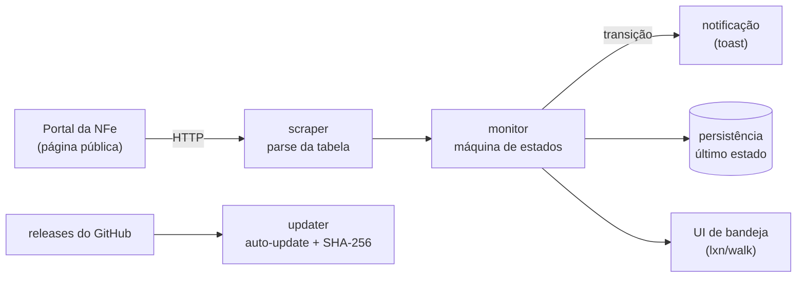

# SEFAZ Monitor

[](https://github.com/brenoluizdev/sefaz-monitor/actions/workflows/ci.yml)


Aplicativo de bandeja para Windows que monitora a disponibilidade dos serviços da
**NFe** por unidade federativa e avisa quando o status de uma UF muda.

---

## O problema

Quem emite nota fiscal em produção precisa saber, em tempo real, se a SEFAZ do seu
estado está respondendo. A consulta oficial (`NFeStatusServico4`) exige **TLS mútuo
com certificado digital ICP-Brasil** — caro e burocrático só para olhar um status.

O portal da NFe publica a mesma informação numa página pública, com semáforo por
autorizador. O problema é que ninguém fica com essa página aberta o dia inteiro.

Este app resolve isso: fica na bandeja, consulta a página em intervalos
configuráveis e notifica **apenas transições de estado** (não fica spammando
"está tudo bem").

## Como funciona



- **scraper** — baixa a página de disponibilidade e interpreta a tabela de
  semáforos, com cookie jar e timeout de 20s.
- **monitor** — classifica cada UF como `Operacional`, `Instável` ou `Indisponível`
  e detecta transições. Quando o portal começa a falhar, aplica **backoff
  exponencial** (até 30 min) em vez de martelar o servidor.
- **ufs** — resolve qual linha da tabela corresponde a cada UF, incluindo os
  ambientes compartilhados **SVRS** e **SVAN**.
- **ui** — ícone na bandeja, janela de configuração, instância única e notificações
  nativas do Windows.
- **updater** — verifica releases, baixa o instalador e valida o checksum SHA-256.

## Stack

| Item | Tecnologia |
| --- | --- |
| Linguagem | Go 1.23 |
| Interface | `lxn/walk` (Win32 nativo) |
| Notificações | `go-toast` |
| Distribuição | Instalador Inno Setup + release automatizado |
| CI | GitHub Actions (windows-latest) |

## Rodando

Requisitos: **Go 1.23+** e Windows (a UI usa Win32).

```bash
git clone https://github.com/brenoluizdev/sefaz-monitor.git
cd sefaz-monitor

go run .            # abre o app na bandeja
go test ./...       # roda a suíte
go build -o SefazMonitor.exe .
```

Para gerar o executável sem console:

```bash
go build -ldflags "-H=windowsgui" -o SefazMonitor.exe .
```

### Instalador

O script `installer/sefaz-monitor.iss` gera o instalador com Inno Setup:

```powershell
& "C:\Program Files (x86)\Inno Setup 6\ISCC.exe" installer\sefaz-monitor.iss
```

## Testes

Três pacotes têm testes automatizados, focados na lógica que não depende de UI:

| Pacote | O que cobre |
| --- | --- |
| `internal/monitor/backoff_test.go` | crescimento e teto do backoff exponencial |
| `internal/monitor/persist_test.go` | persistência e restauração do estado |
| `internal/updater/updater_test.go` | comparação de versões e validação do update |

O CI roda `go build ./...` e `go test ./...` em `windows-latest` a cada push.

## Release e auto-update

Ao enviar uma tag `vX.Y.Z`, o workflow `.github/workflows/release.yml`:

1. injeta a versão no binário via `-ldflags "-X sefazmonitor/internal/version.Current=..."`;
2. compila com `-H=windowsgui`;
3. gera o instalador com Inno Setup;
4. calcula o SHA-256 do instalador;
5. publica tudo como assets do release (de forma idempotente).

É exatamente esse conjunto que o `internal/updater` consulta em runtime. Builds
locais ficam com versão `dev`, o que desativa a checagem de atualização.

## Limitações

- **Windows only**: a interface usa a API Win32 via `lxn/walk`.
- Depende do formato da página pública da NFe. Se o portal mudar o HTML, o parser
  precisa de ajuste (os testes ajudam a detectar regressões de lógica, não de markup).

## Estrutura

```
main.go                 ponto de entrada
internal/
  config/               preferências persistidas
  monitor/              polling, máquina de estados e backoff
  scraper/              download e parse da página da NFe
  ufs/                  metadados das 27 UFs e seus autorizadores
  ui/                   bandeja, configurações, notificações
  updater/              verificação e download de updates
installer/              script do Inno Setup
tools/                  utilitários de desenvolvimento (ícone, teste de query etc.)
```

---

Feito por [Breno Luiz](https://github.com/brenoluizdev) · [LinkedIn](https://www.linkedin.com/in/brenoluizdev/)
